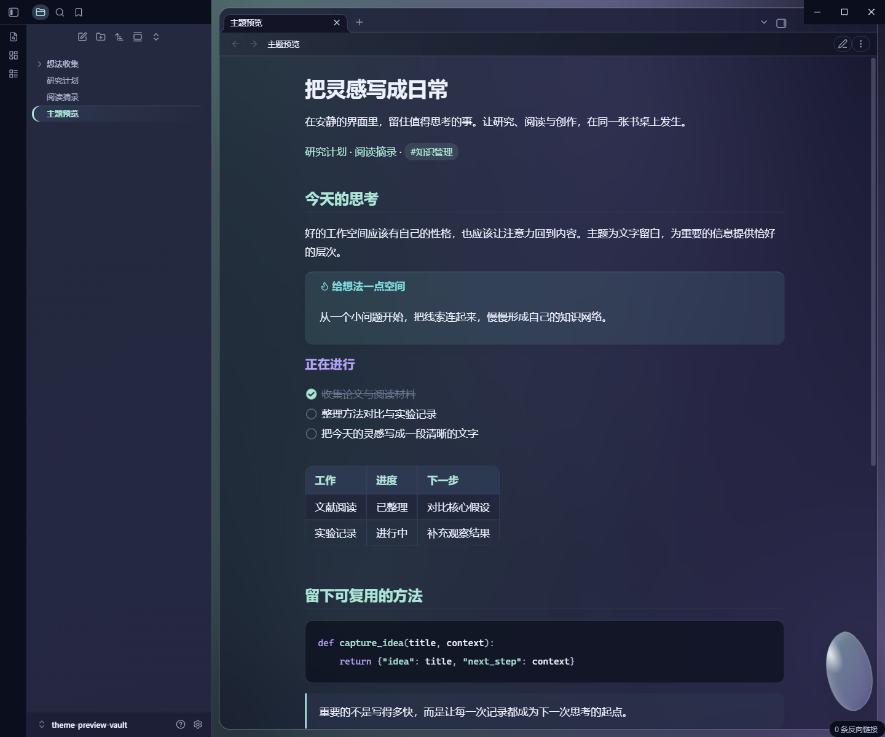
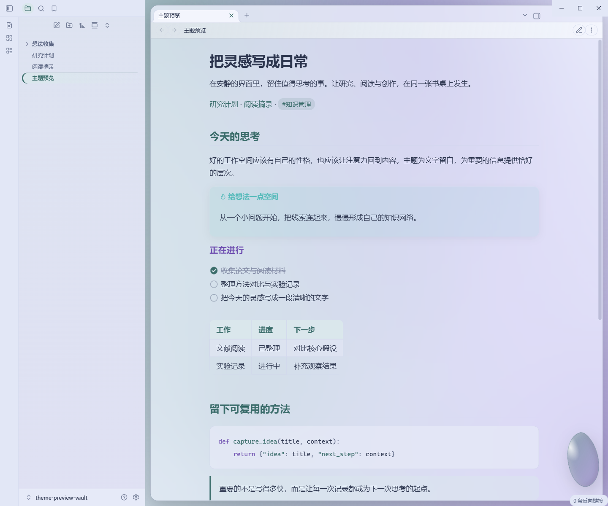
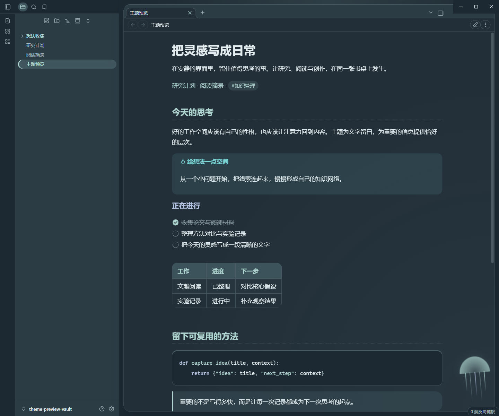
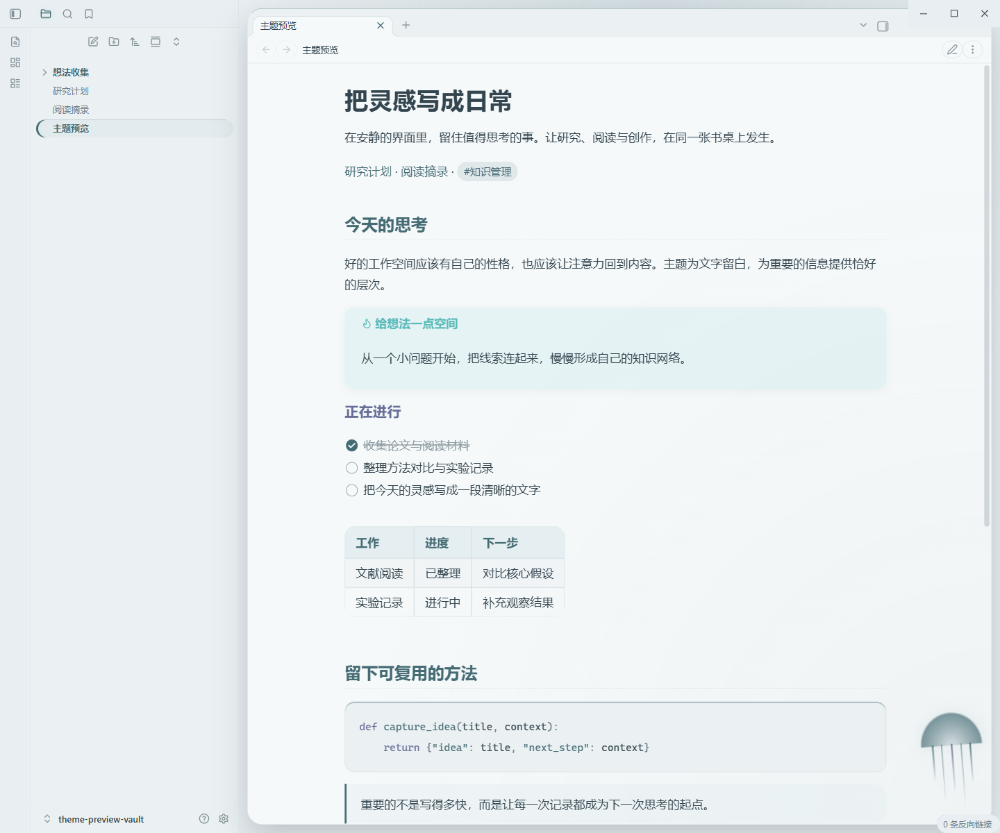
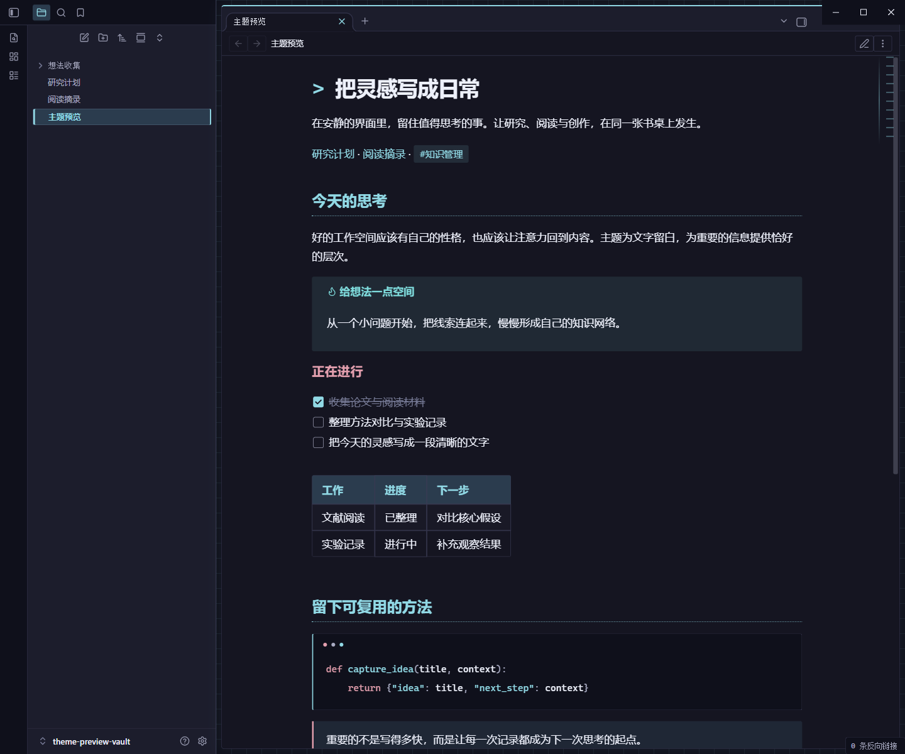
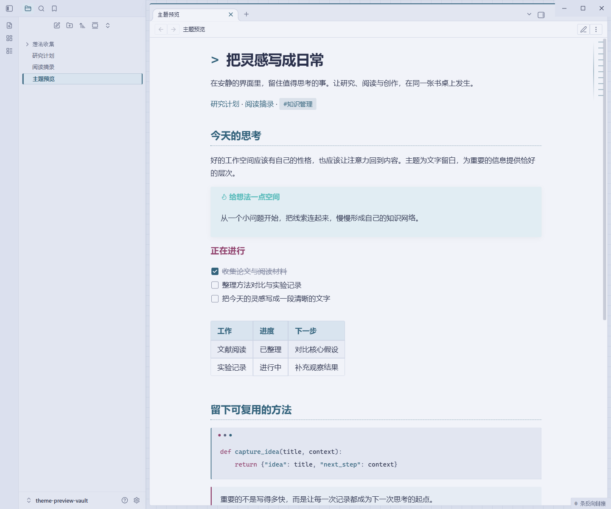

# NK Obsidian Themes

三套带有独立视觉风格与环境动效的 Obsidian 原生主题，支持明暗模式。纯 CSS，无插件依赖，不请求外部字体或图片。

Three native Obsidian themes with light/dark palettes, ambient motion, and local-only assets.

| Theme | 风格 |
| --- | --- |
| **NK - Aurora Glass** | 保留薄荷绿与紫色配色，流动极光穿过半透明面板；磨砂玻璃、高光边缘、悬浮晶体 |
| **NK - Abyssal Bloom** | 低饱和、较浅的海蓝与灰青底色，柔和的荧光水母 |
| **NK - Neon Circuit** | 细网格、终端标题、代码窗与扫描光轨 |

## 预览

以下均使用单独的示例笔记库在 Obsidian 1.14.4 中截图。

### Aurora Glass · 极光玻璃

| Dark | Light |
| --- | --- |
|  |  |

### Abyssal Bloom · 深海浮光

| Dark | Light |
| --- | --- |
|  |  |

### Neon Circuit · 霓虹回路

| Dark | Light |
| --- | --- |
|  |  |

## 安装 / Install

1. 在 [Releases](https://github.com/newkingyeah/obsidian-nk-themes/releases/latest) 下载整套或单个主题 ZIP。
2. 解压后，把 `NK - Aurora Glass` 等主题文件夹复制到笔记库的 `.obsidian/themes/`。每个文件夹内应直接包含 `theme.css` 和 `manifest.json`。
3. 打开 **设置 → 外观 → 主题**，选择主题名称。
4. 在 **基础颜色** 中选择明亮或暗色。

也可以克隆仓库后，直接复制 `themes/` 下的文件夹。主题尚未提交到 Obsidian 社区主题目录。

Extract a theme folder into `<vault>/.obsidian/themes/`, then select it in **Settings → Appearance → Themes**. Switch light/dark using the base color scheme setting.

## 特性

- 正文与目录排版、标签页、属性、代码块、表格、提示框、弹出菜单及设置控件。
- 动效位于编辑区边缘，不接收点击，不移动正文。
- 遵循系统 `prefers-reduced-motion` 设置。较小窗口会降低装饰强度，手机宽度隐藏装饰。
- Aurora Glass 对不支持背景模糊的环境提供不透明面板回退。
- 系统字体优先，无远程字体、图片或脚本。

最低应用版本：1.10.6。已在 Windows / Obsidian 1.14.4 检查六种明暗外观和 720px 窄窗口。其他平台主要通过原生变量兼容，尚未逐一验证。

## 自定义 / Customize

`themes/<主题名>/theme.css` 开头定义明暗配色，所有颜色使用 `--nk-*` 变量。可直接编辑：

- `--nk-accent`：主要强调色
- `--nk-secondary`：次要强调色
- `--nk-radius`：面板圆角
- `--nk-gap`：面板间距
- `--file-line-width`：笔记阅读宽度

若某个旧 CSS 片段修改了同样的颜色或背景，可先停用它，再预览主题。

## 从源码构建 / Build from source

需要 Python 3.10+，不依赖第三方包。

```sh
python scripts/build.py
python scripts/build.py --check
python scripts/build.py --check --package
```

在 `src/themes.py` 修改设计变量和样式，重新构建后提交生成的 `themes/`。`--check` 会验证生成文件是否与源码一致，并检查基础正文配色的对比度；它不代替在 Obsidian 中做视觉检查。`dist/` 中的 ZIP 适用于手动安装。

## License

[MIT](LICENSE) © 2026 newkingyeah. Obsidian is a separate product and is not included in this repository.
